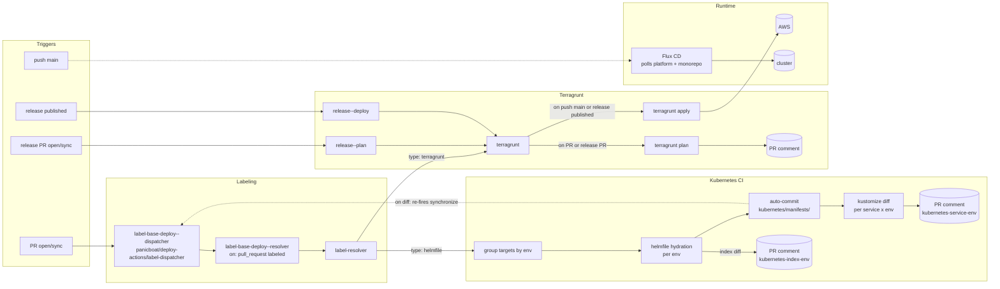

# Platform

[🇺🇸 English](README.md) | **日本語**

## 📖 Overview

ラベル駆動の単一 CI パイプラインから 4 つのデプロイ面を管理する monorepo:

- **AWS infrastructure** — Terragrunt + OpenTofu ([aws/](aws/))
- **GitHub configuration** — Repo / branch / ruleset 設定を Terragrunt で管理 ([github/](github/))
- **GCP infrastructure** — Terragrunt + OpenTofu ([gcp/](gcp/))
- **Kubernetes platform** — Helmfile でレンダリングしたマニフェストを Flux CD で適用 ([kubernetes/](kubernetes/))

`panicboat/deploy-actions` が PR に付与したラベルを [workflow-config.yaml](workflow-config.yaml) に基づき具体的なデプロイ対象に展開し、対応する reusable workflow が実行される。

## 📂 Structure

```
.
├── .github/
│   └── workflows/       # panicboat/.github の shared workflow を呼ぶ workflow
├── aws/                 # service ごとの Terragrunt stack ({environment})
├── github/              # GitHub repo / branch 設定の Terragrunt stack
├── gcp/                 # GCP の Terragrunt stack（GCP プロジェクトの表示名ごとのディレクトリ）
├── kubernetes/
│   ├── clusters/        # cluster ごとの Flux bootstrap
│   ├── components/      # environment ごとの Helmfile source
│   └── manifests/       # Flux が適用するレンダリング済みマニフェスト
├── docs/                # runbook と設計ノート
├── scripts/             # EKS lifecycle 用 helper
├── Makefile             # EKS teardown entry point
└── workflow-config.yaml # environment と stack convention の source of truth
```

## 🚢 Deployment

### Trigger

| Event | Workflow | Terragrunt |
|-------|----------|------------|
| PR に `deploy:{service}` ラベルが付く | [label-base-deploy--resolver.yaml](.github/workflows/label-base-deploy--resolver.yaml) | すべての target を plan |
| `main` への push | [label-base-deploy--resolver.yaml](.github/workflows/label-base-deploy--resolver.yaml) | `production` 以外の environment の target を apply |
| release PR の作成・更新 | [release--plan.yaml](.github/workflows/release--plan.yaml) | その service の production の environment を plan |
| release の公開 | [release--deploy.yaml](.github/workflows/release--deploy.yaml) | その service の production の environment を apply |

#### Targets

- PR の作成・更新時に、[label-base-deploy--dispatcher.yaml](.github/workflows/label-base-deploy--dispatcher.yaml) が `deploy:{service}` ラベルを付ける。release-please の branch にはラベルを付けない。
  - module や `root.hcl` を含め、`aws/{service}/` 配下のどの変更でもラベルが付く。
- `label-resolver` が [workflow-config.yaml](workflow-config.yaml) の `services[].stacks` を読み、ラベルをその service の全 environment に展開する。
- 各 target は、`type` 属性（`terragrunt` または `helmfile`）に対応する workflow に渡される。
- `terragrunt` stack の `exclude` に一致する `{service}/{environment}` の組は、release も含めて plan も apply もされない。
  - `environment` だけの rule はすべての service に効く。

#### Releases

- production の environment を持つ `aws/{service}` は、それぞれ release-please の設定（`release-please-config.json` / `release-please-manifest.json`）を持つ。
  - 設定がないと [test-terragrunt-release.yaml](.github/workflows/test-terragrunt-release.yaml) が CI を失敗させる。
- production 以外の environment ディレクトリだけを変える commit も、その service の release-please package の変更として数えられる。
- production の environment が除外されている間も release PR は作られるが、plan も apply もされない。
- plan を出し直すときは、`Release - Plan` の run で「Re-run all jobs」を使う。
- apply を再実行するときは、`gh workflow run release--deploy.yaml --ref {service}-vX.Y.Z -f tag={service}-vX.Y.Z` を実行する。

### Stacks

| Stack | Path convention | Tooling |
|-------|-----------------|---------|
| AWS infrastructure | `aws/{service}/{environment}` | Terragrunt + OpenTofu |
| GitHub configuration | `github/{service}/{environment}` | Terragrunt + OpenTofu |
| GCP infrastructure | `gcp/{project}/{service}/{environment}` | Terragrunt + OpenTofu |
| Kubernetes platform | `kubernetes/components/{service}/{environment}` | Helmfile → Kustomize hydration → Flux CD |

### Environments and Authentication

- Terragrunt の environment は [workflow-config.yaml](workflow-config.yaml) の `services[].stacks[].environments` で宣言し、AWS region と IAM role は `profiles` に置いて environment の `use` で参照する。Helmfile の環境は宣言せず、`kubernetes/components/{service}/` のディレクトリから探索する。Terragrunt の環境の追加・削除は同ファイルの編集で行う。
- `terragrunt` stack は、名前が `production` の environment を service の release が公開されたときに apply し、それ以外の environment を `main` への push で apply する。
- 認証は GitHub OIDC。[aws/github-oidc-auth/](aws/github-oidc-auth/) が environment ごとの plan / apply role を発行し、executor がそれを引き受ける。
- GCP の stack も master の plan / apply role を使う。[gcp/github-actions-master/workload-identity/](gcp/github-actions-master/workload-identity/) が CI 用の project を作り、その Workload Identity Federation で AWS の credential を GCP の credential に交換する。CI のときだけ [gcp/credential-configuration.json](gcp/credential-configuration.json) を使い、手元では gcloud の application default credentials を使う。
- `{project}` は GCP プロジェクトの表示名。表示名と異なることがある project ID は `{project}/project.hcl` に書く。
- CI 用の project の workload-identity の stack は、CI がまだ GCP に入れないため、最初に手元から apply する。CI の principal に付ける組織と請求先アカウントの権限（apply は project の作成と請求先アカウントの利用、plan は閲覧）は手作業で付け、apply role に組織の IAM を管理させない。
- `{service}` は、`aws/`・`github/`・すべての GCP プロジェクトを通して、ほかの stack と違う名前にする。`deploy:{service}` ラベルと tfcmt の target は provider も GCP プロジェクトも含まないので、同じ名前だと両方の stack が plan され、plan コメントが互いに上書きされる。
- `platform` と `monorepo` の GitHub environment `production` は、tag pattern `*-v*` に一致する ref からの deployment だけを受け付ける。これらの設定は [github/repository/](github/repository/) で管理する。
- Terragrunt の remote state は S3 + DynamoDB に保存される。bucket / lock table 名は各 `aws/{service}/root.hcl`（および [github/](github/)・[gcp/](gcp/) 配下の同等ファイル）で定義される。state key は `platform/<リポジトリ root からの unit のパス>/terraform.tfstate` で、provider をまたいでもぶつからない。

### Pipeline Flow



### GitOps Sync (Flux CD)

- Flux bootstrap は `kubernetes/clusters/{cluster}/flux-system/` に置く。cluster の root Kustomization が `kubernetes/manifests/{cluster}/` 配下のレンダリング済みマニフェストと外部 `GitRepository`（現状はアプリケーション monorepo）を集約する。
- Platform と application の repository は別々に pull され、疎結合に保たれる。同期間隔や source URL は `kubernetes/clusters/{cluster}/` 配下のマニフェストが source of truth。
- [kubernetes/components/](kubernetes/components/) を変更する PR では CI がコンポーネントをレンダリングし、その結果を [kubernetes/manifests/](kubernetes/manifests/) にコミット、差分を PR コメントに投稿する。マージ後に Flux が適用する。
